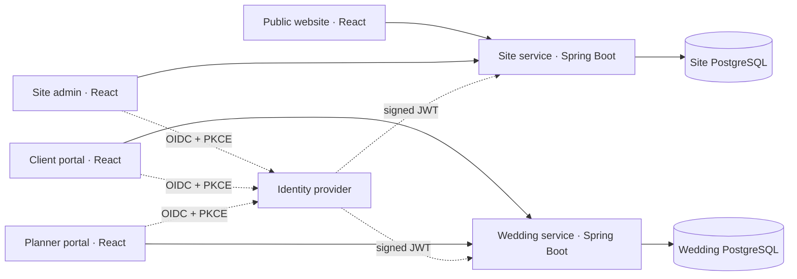

# Architecture decision — 3 November 2026

## Decision

Use four independently built React + TypeScript + Vite applications, two independently deployed Spring Boot services, PostgreSQL per service, and a shared OIDC identity provider. Use Keycloak for local development; a compatible managed OIDC provider can replace it by preserving the documented role/audience claims.

The user confirmed that site administration (prices, rental catalogue and site content) is distinct from the wedding planner portal. Roles are `SITE_ADMIN`, `PLANNER` and `CLIENT`. Site administration does not imply permission to inspect couples' wedding records.

Separate frontends are applications, not backend microservices. The two services follow business/data ownership boundaries. The client and planner both operate on the same wedding records, so splitting their backends by screen would create duplicated data and fragile synchronization. Content, products, stock, bookings and closures initially stay in one site service so stock reservation remains a local transaction. Split rentals out only when independent scale or team ownership justifies it.

There is no shared database, cross-service table join, cross-app localStorage dependency, runtime shared source directory, service discovery layer, message broker or distributed transaction. Explicit URLs and synchronous HTTP are sufficient for the present scope. If booking-to-wedding workflows are added later, use versioned events with a transactional outbox and idempotent consumers; do not dual-write databases.

## Why React and Spring Boot

The existing implementation is vanilla JavaScript/HTML/CSS: Node HTTP servers and SQLite for the public site/admin; standalone HTML with localStorage for the planning prototypes. There is no existing React or Spring project to retain.

React is a good fit for reusable task, contact, form and dashboard components. TypeScript makes API assumptions visible. The existing CSS, visual palette, sample content and pure pricing rules can be retained. React still renders HTML and uses CSS; these technologies are complementary. Vite provides independent static bundles without tying the backend to a JavaScript server framework. [React documents this build-tool approach](https://react.dev/learn/build-a-react-app-from-scratch).

Spring Boot is a reasonable long-term backend choice for server-side authorization, transactional writes, validation, migrations and Java maintenance. It requires more memory and operational work than the current small Node servers. A modular Node backend would remain cheaper to operate if the goal were only to keep the existing small prototype online. Given the requested service separation and explicit Java preference, Spring Boot is justified; the original Node implementation is preserved as the migration reference.

The baseline pins Spring Boot 3.5.16 and Java 21, a compatible pair documented in [Spring Boot system requirements](https://docs.spring.io/spring-boot/3.5/system-requirements.html). It avoids adding a framework-major migration to the source split. React/Vite dependencies are exact versions with lockfiles. Reassess supported release lines and dependency updates before production launch. Local identity pins [Keycloak 26.8.1](https://www.keycloak.org/downloads).

The public site is presently rendered in the browser, as was the original. Add prerendering or server rendering for public marketing routes before an SEO-focused launch; the private portals do not need it. This does not require replacing Spring Boot or combining the repositories.

## Identity and authorization

- Each frontend is an independent public OIDC client, using authorization code + S256 PKCE. No client secret is shipped to browsers.
- APIs validate token signature, issuer, expiry and the service-specific audience (`ehe-site-api` or `ehe-wedding-api`). Realm roles become Spring authorities.
- Wedding ownership is stored server-side as `plannerSub` and `clientSub`. Every detail and mutation checks the authenticated subject. An unknown or unassigned wedding returns 404.
- Only planners can create weddings, tasks and contacts. Couples may comment and change the status of couple-owned tasks. Planner-only notes and assignment subjects are omitted from client responses.
- An access token is kept in sessionStorage by the OIDC library and expires; stale sessions require sign-in again. This baseline has no automatic silent renewal or BFF cookie layer.
- The planner project form currently requires an existing client account ID. Account invitations, account lookup, multiple planners and two separate partner accounts are follow-up work.

## Persistence and consistency

Each service has a Flyway-managed `app_state` table containing its JSON document. PostgreSQL row locks serialize writes; revision checks reject stale settings/catalogue and task-status changes with 409. Bookings use caller request UUIDs, compare the original input on retry and calculate price server-side. Stock checks and booking insertion occur in the same locked transaction. Rental periods retain 36 hours of customer use, 48 hours of reserved inventory, and 10% extra per additional day. Calendar boundaries use Europe/Tallinn.

This document store is an explicit migration-stage tradeoff: it keeps the prototype shapes reviewable and gives durable, atomic changes, but rewrites one document and serializes all writes within a service. It is not a high-throughput database design. Before scaling, migrate to normalized weddings/memberships/tasks/comments and products/reservations/closures tables, retaining API contracts and invariant tests. Use row-level product locks rather than a service-wide lock then.

## Production boundary

The compose file is local-only. Before public launch, supply production identity/HTTPS configuration, per-service credentials and backups, request size/rate limits and booking-abuse controls, audit trails, deployment monitoring and recovery procedures. Replace development identity storage and demo users, migrate existing data deliberately, verify real PostgreSQL concurrency and OIDC in staging, complete the migration matrix and perform responsive/accessibility QA. These are concrete gaps in this baseline, not claims that the existing local prototypes already supplied them.

Existing Sites hosting manifests remain with the untouched source projects. They are not copied into the new repositories: a Spring Boot JVM cannot run in the existing Cloudflare Worker runtime. Choose JVM/container hosting for APIs and static hosting or containers for React apps. No hosting change was performed in this task.
